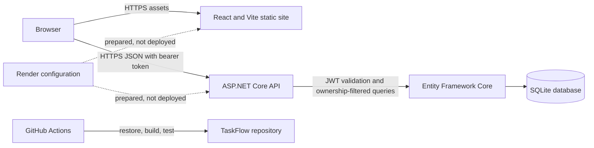

# TaskFlow

TaskFlow is a full-stack project and task management application. It gives individuals a single place to organize projects, track task status and priority, set deadlines, and review work from a dashboard. It is being prepared as a portfolio release; it is **not currently deployed**.

## Features

- Register and sign in with a username or email.
- Create, view, update, search, and delete projects.
- Create and manage project tasks with status, priority, due dates, and optional assignees.
- Clear optional project and task fields during partial updates.
- Review project and task totals, status and priority breakdowns, recent tasks, and upcoming deadlines.
- Isolate project and task operations by the authenticated user's ownership.
- Use the responsive interface on desktop, tablet, and mobile screens.

## Technology

| Area | Stack |
|---|---|
| API | C#, ASP.NET Core Web API, .NET 10 |
| Data | Entity Framework Core 10, SQLite, EF Core migrations |
| Authentication | JWT bearer tokens, BCrypt password hashing |
| Client | React 19, JavaScript, Vite, React Router, Axios |
| Tests | xUnit, ASP.NET Core integration testing, Playwright |
| Packaging and CI | Docker, GitHub Actions |
| Deployment configuration | Render Blueprint for a static site and API service |

## Architecture

The browser loads the React application and sends authenticated JSON requests to the API. The API validates JWTs, applies ownership filters, and uses EF Core to access SQLite. GitHub Actions is configured to build and test the application; it does not deploy it.



## Authentication and security

- Passwords are stored as BCrypt hashes; API authentication uses signed JWT bearer tokens.
- The API checks token signature, issuer, audience, and lifetime. Issued tokens currently expire after 60 minutes.
- Project queries are scoped to the authenticated user's ID. Task routes verify that the parent project belongs to that user.
- Registration and login validation errors use Problem Details. Login errors do not reveal whether the identifier exists.
- A 401 response clears the client token and protected routes send the user back to login. There is no refresh-token endpoint.
- The client currently stores its bearer token in `localStorage`. This keeps sessions across refreshes but means an XSS vulnerability could expose the token; continue to avoid unsafe HTML and keep dependencies current.
- Production requires a signing key of at least 32 bytes, an absolute SQLite database path, and HTTPS CORS origins. Real keys belong in the host's secret store, never in this repository or in a `VITE_` variable.

## Project structure

```text
TaskFlow/
├── .github/workflows/ci.yml       # Build, test, lint, Playwright
├── TaskFlow.API/                  # ASP.NET Core API, EF Core, migrations
├── TaskFlow.Client/               # React application and Playwright tests
│   ├── e2e/
│   └── src/
├── TaskFlow.Tests/                # xUnit unit and HTTP integration tests
├── render.yaml                    # Prepared Render services; not applied
├── TaskFlow.slnx
└── README.md
```

## API overview

All project and task endpoints require `Authorization: Bearer <token>`. `/api/auth/register` and `/api/auth/login` are public; `/api/auth/me` requires authentication.

| Area | Routes |
|---|---|
| Authentication | `POST /api/auth/register`, `POST /api/auth/login`, `GET /api/auth/me` |
| Projects | `GET /api/projects`, `GET /api/projects/{id}`, `POST /api/projects`, `PUT /api/projects/{id}`, `DELETE /api/projects/{id}` |
| Tasks | `GET/POST /api/projects/{projectId}/tasks`, `GET/PUT/DELETE /api/projects/{projectId}/tasks/{taskId}` |
| Dashboard | `GET /api/dashboard` |
| Health | `GET /api/health`, `GET /api/health/live`, `GET /api/health/ready` |

`/api/health` and `/api/health/live` are liveness checks. Readiness checks database connectivity and returns 503 when the database cannot be reached. The API also contains a default `/WeatherForecast` scaffold endpoint; it is not used by the TaskFlow client.

### Validation and task values

Project names are limited to 100 characters and descriptions to 1,000. Task titles are limited to 150 characters and descriptions to 2,000. Invalid model and controller validation responses use HTTP 400 Problem Details. Missing or inaccessible project/task resources return 404; missing or invalid bearer authentication returns 401.

Task statuses are `ToDo` (0), `InProgress` (1), `Review` (2), `Done` (3), and `Blocked` (4). Priorities are `Low` (0), `Medium` (1), `High` (2), and `Urgent` (3). When updating a project or task, an omitted property is preserved; send `null` to clear supported nullable properties (`description`, `dueDate`, and task `assigneeId`).

## Local setup

### Prerequisites

- .NET 10 SDK
- Node.js 22 and npm
- Git
- Docker for container instructions
- Playwright Chromium for browser tests

Clone the repository, then restore and install dependencies:

```bash
git clone <repository-url>
cd TaskFlow
dotnet restore TaskFlow.slnx
cd TaskFlow.Client
npm ci
cd ..
```

### Configure the API

The development SQLite connection defaults to `Data Source=taskflow.db` under the API working directory. The local database is ignored by Git. Supply the JWT signing key through .NET User Secrets:

```bash
dotnet user-secrets set "JwtSettings:Key" "<private-development-key>" --project TaskFlow.API
```

Use a privately generated development key of at least 32 bytes. Do not put the key in `appsettings.json`, source control, a frontend variable, or a screenshot. Local development CORS allows the Vite origin at `http://localhost:5173`.

The existing `InitialCreate` EF migration creates the SQLite schema. Install the EF command-line tool if needed, then apply migrations from the repository root:

```bash
dotnet tool install --global dotnet-ef --version 10.0.15
dotnet ef database update --project TaskFlow.API
```

In the `Testing` environment, the API applies migrations when the configured database provider is relational (the Playwright runner uses a temporary SQLite database). In-memory integration tests do not need migrations. Outside tests, startup migrations are opt-in with `Database__ApplyMigrationsOnStartup=true`.

### Run the API and client

Start the backend from the repository root:

```bash
dotnet run --project TaskFlow.API --launch-profile http
```

The API listens at `http://localhost:5258`. Start the frontend in a second terminal:

```bash
cd TaskFlow.Client
npm run dev
```

Vite listens at `http://localhost:5173`. In development the client defaults to `http://localhost:5258/api`. For a separate production API host, set `VITE_API_BASE_URL` at frontend build time; see [`TaskFlow.Client/.env.production.example`](TaskFlow.Client/.env.production.example). Vite variables are public build output and must never contain secrets.

## Tests and quality checks

Run backend checks from the repository root:

```bash
dotnet build TaskFlow.slnx --nologo
dotnet test TaskFlow.slnx -m:1
```

Run frontend checks from `TaskFlow.Client`:

```bash
npm ci
npm run lint
npm run build
```

The xUnit suite includes controller tests and HTTP integration tests for JWT authentication, ownership, validation, nullable updates, authentication responses, and health checks. Integration tests use isolated in-memory or temporary databases and test-only signing keys.

### Playwright browser tests

Install Chromium once and run from `TaskFlow.Client`:

```bash
npx playwright install chromium
npm run test:e2e
```

The runner starts the API and Vite using isolated test configuration, a random test-only JWT key, and a temporary SQLite database that it removes afterward. It does not use User Secrets or the developer's database. Tests cover registration, login/logout, refresh and invalid-session handling, project and task CRUD, nullable-field clearing, dashboard data/states, and desktop/tablet/mobile layouts. Failed-test screenshots, traces, and video are written under the ignored `test-results/` directory. Set `TASKFLOW_E2E_API_URL` and `TASKFLOW_E2E_CLIENT_URL` to use different local ports.

## Docker

Build the API image from the repository root:

```bash
docker build -f TaskFlow.API/Dockerfile -t taskflow-api .
```

For a local-only container with persistent data, create a Docker volume and run the image. Replace the example key with a private development key; this command is not a production deployment recipe:

```bash
docker volume create taskflow-data
docker run --rm -p 5258:10000 \
  -v taskflow-data:/var/data \
  -e ASPNETCORE_ENVIRONMENT=Development \
  -e JwtSettings__Key='<private-development-key-of-at-least-32-bytes>' \
  -e ConnectionStrings__DefaultConnection='Data Source=/var/data/taskflow.db' \
  -e Database__ApplyMigrationsOnStartup=true \
  taskflow-api
```

The container runs as a non-root user. Production deployment additionally needs HTTPS termination, a configured HTTPS CORS origin, secret management, and persistent storage.

## CI

`.github/workflows/ci.yml` is configured for pushes and pull requests. It sets up .NET 10 and Node 22, restores/builds/tests the backend, runs `npm ci`, lint and the frontend build, installs Playwright Chromium, runs E2E tests, and uploads browser diagnostics even when a job fails. It contains no deployment credentials. The workflow has not been verified by a remote GitHub Actions run yet.

## Deployment preparation

`render.yaml` describes a Render static site and a paid Docker API service. The API uses a 1 GB persistent disk at `/var/data` for `taskflow.db`, startup migrations are explicitly enabled, the JWT key is generated by Render, and automatic deploys are disabled. This configuration is prepared but has **not** been applied; TaskFlow has no live URL.

The free Render web tier cannot keep SQLite files on a persistent disk. The prepared paid API service is a single instance, so SQLite is suitable only for this small portfolio deployment. Confirm service and disk pricing, mount permissions, HTTPS/CORS settings, migrations, backup procedures, and restart persistence before creating services. A separate tested backup/export process is still required. Move to a managed database before scaling to multiple API instances or needing concurrent multi-host writes.

Production environment settings are supplied through the hosting provider, not committed files:

| Setting | Purpose |
|---|---|
| `ASPNETCORE_ENVIRONMENT=Production` | Enables production error handling and logging. |
| `JwtSettings__Key` | Secret signing key (at least 32 bytes). |
| `JwtSettings__Issuer`, `JwtSettings__Audience`, `JwtSettings__ExpiryMinutes` | JWT validation and expiry configuration. |
| `Cors__AllowedOrigins__0` | Exact HTTPS frontend origin. |
| `ConnectionStrings__DefaultConnection` | Absolute SQLite file path on persistent storage. |
| `Database__ApplyMigrationsOnStartup=true` | Applies reviewed EF migrations at startup for the single instance. |
| `Hosting__HttpsTerminatedAtProxy=true` | Use only when the host guarantees edge TLS termination and HTTP redirection; the API does not trust forwarded headers. |
| `VITE_API_BASE_URL` | Public build-time API URL ending in `/api`; never a secret. |

## Known limitations and future work

- The project is not deployed and the GitHub Actions workflow has not yet run remotely.
- SQLite on one persistent disk is a single-instance design; there is no configured independent backup job.
- Assignees are selected by numeric user ID rather than from a user directory.
- Lists are not paginated, and the dashboard requests tasks per project.
- Authentication has no refresh-token or rate-limiting mechanism. Registration does not currently enforce email syntax or explicit maximum username/email lengths.
- The default `/WeatherForecast` scaffold endpoint remains in the API but is unused by TaskFlow.
- Portfolio screenshots have not been captured; see the manual capture checklist below.

Potential next steps are a user-directory assignee selector, task filtering/pagination, authentication rate limits, independent backups, and a managed database if the deployment needs to scale.

## Portfolio screenshot checklist

Capture screenshots manually from a local run using a disposable account and sample data. Do not include real credentials, tokens, private email addresses, or fabricated product imagery.

1. **Dashboard:** show several projects, tasks with more than one status/priority, one upcoming deadline, and a completed task; keep the sidebar visible.
2. **Projects:** show the project list with names, descriptions, due dates, and search in its normal state.
3. **Tasks:** show a selected project and tasks with status, priority, due date, and assignee information.
4. **Login:** show the empty sign-in form, with no username or password entered.
5. **Registration:** show the empty registration form, with no personal information entered.
6. **Architecture:** export or capture the Mermaid diagram above as a separate architecture image if the portfolio site needs a static asset.

Capture at a consistent desktop viewport for the main portfolio images. Optionally capture a separate mobile dashboard to demonstrate responsive layout. No screenshot is included in this repository yet.

## Release checklist

- Run the checks above and review the complete Git diff.
- Push the reviewed repository changes yourself so GitHub can run the workflow.
- Review the Render Blueprint and charges before applying it; then verify the deployed service manually.
- Capture portfolio screenshots only after creating non-sensitive demonstration data.
- Prepare a v1.0.0 release from a clean, reviewed Git state; no release tag has been created.

## Author

Simphiwe Mbatha
